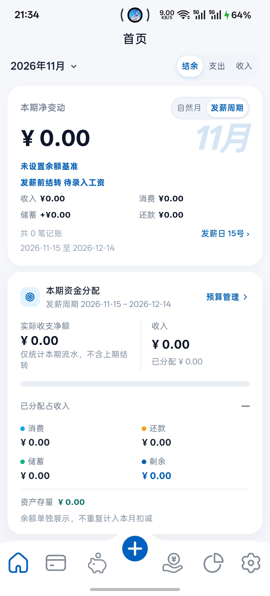
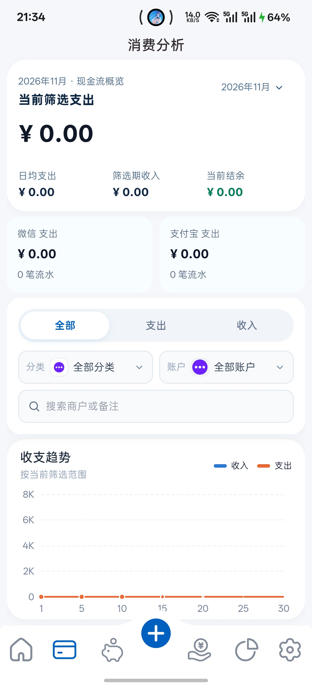
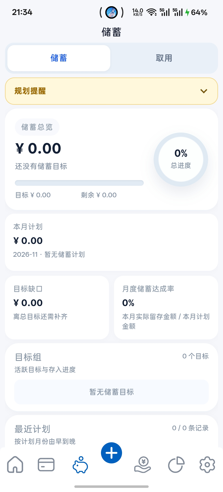
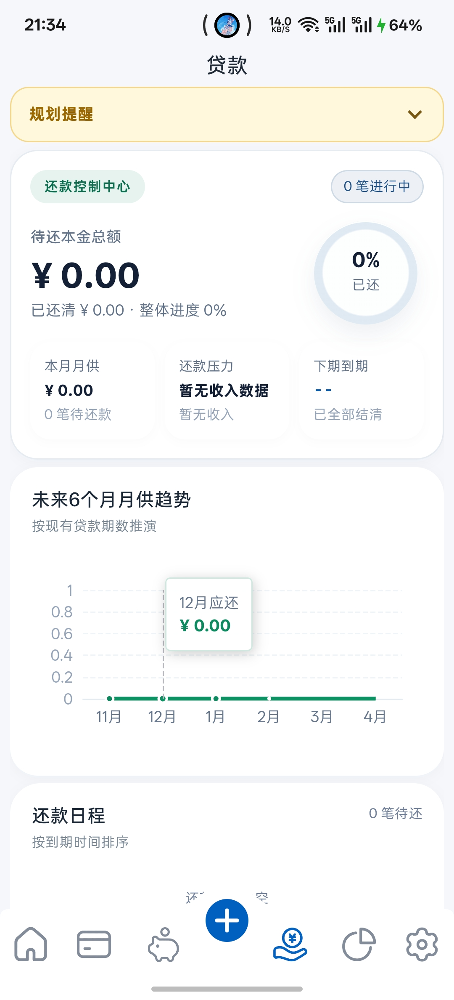
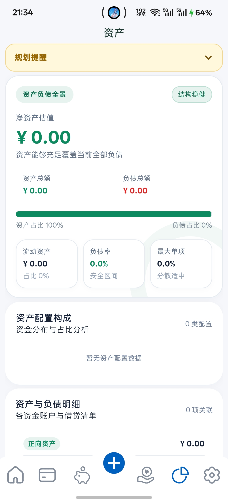
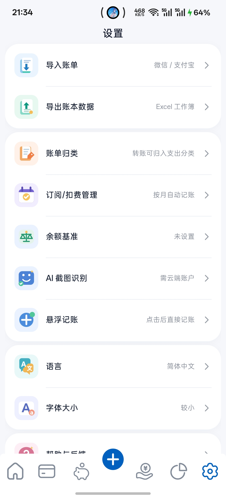

# 星会计（Wotty Star Accounting）

<p align="center"></p>

<p align="center">
  <a href="https://github.com/wottyup/star-accounting/blob/main/LICENSE"></a>
  <a href="https://github.com/wottyup/star-accounting/releases"></a>
  <a href="https://github.com/wottyup/star-accounting/releases"></a>
  <a href="https://github.com/wottyup/star-accounting/stargazers"></a>
  <a href="https://github.com/wottyup/star-accounting/issues"></a>
</p>
<p align="center">
  <a href="docs/android-app-editions.md"></a>
  <a href="app/package.json"></a>
  <a href="app/package.json"></a>
  <a href="server-go/"></a>
  <a href="app/android/build.gradle"></a>
</p>

星会计是面向个人的记账与财务规划应用。记录收支后，可以按自然月或发薪周期查看资金变化，安排预算和储蓄计划，并管理资产、贷款及固定扣费。项目提供网页和 Android 版本。

在线体验：[打开 Web 演示](https://s.wotty.app/web-demo/app/)。

**Android 公测版下载：**请在 [GitHub 发布页面](https://github.com/wottyup/star-accounting/releases) 查看可用安装包。

**Docker 镜像包：**Android 公测版的[GitHub 发布页面](https://github.com/wottyup/star-accounting/releases)同时提供版本化镜像包和 SHA-256 校验文件；也可[在 GitHub Actions 单独构建并下载](https://github.com/wottyup/star-accounting/actions/workflows/docker-image-package.yml)（Linux amd64，仅包含 Web 和 Go API；部署机器需联网拉取 MySQL 和 Alpine）。

## 主要功能

- **收支与账单**：记录收入、支出和账户流水，导入微信、支付宝账单，查看消费结构与趋势。
- **预算与资金分配**：按分类管理预算，结合薪资收入、计划支出和储蓄目标查看可支配金额。
- **储蓄、资产与贷款**：管理储蓄目标、资产余额和还款计划，并用相关账单核对计划执行情况。
- **订阅/扣费管理**：为订阅、保险、还款等固定支出设置日期和金额，到期自动记账。
- **本地与云端账本**：Android 可选择设备本地账本或登录云端账本；浏览器使用云端账本。
- **完整账本导出与恢复**：设置页可导出一个 Excel 工作簿，账单、资产、预算、贷款、储蓄、周期扣费等分别保存到工作表。在“导入账单 → 本应用导出账单”选择该文件，核对数量后恢复为新的账本副本，保留原账本；设置页可切换账本。请保留全部工作表和字段名称；图片凭证使用“长文本”表分段保存。云端恢复需要同步更新 API 服务，导入失败会全部回滚，同一文件重复导入不会重复记账。导出范围为当前账本及其参考配置，不含其他账本或账户登录凭据。

## 页面预览

以下为 Android `0.8.0-beta.1` 的空账本页面。点击图片可查看原尺寸。

<table>
  <tr><th>首页</th><th>消费分析</th><th>储蓄</th></tr>
  <tr>
    <td><a href="docs/screenshots/home.jpg"></a></td>
    <td><a href="docs/screenshots/consumption.jpg"></a></td>
    <td><a href="docs/screenshots/savings.jpg"></a></td>
  </tr>
  <tr><th>贷款</th><th>资产</th><th>设置</th></tr>
  <tr>
    <td><a href="docs/screenshots/loans.jpg"></a></td>
    <td><a href="docs/screenshots/assets.jpg"></a></td>
    <td><a href="docs/screenshots/settings.jpg"></a></td>
  </tr>
</table>

## 版本与数据模式

| 版本 | 页面与导航 | 本仓库能否构建 |
| --- | --- | --- |
| Web 壳版（`com.wotty.stark.web`） | Capacitor WebView 与网页底栏 | 可以 |
| KT 混合版（`com.wotty.stark.ktweb`） | 同一套网页页面与 Kotlin 原生底栏 | 可以 |
| 纯 KT 原生版（`com.wotty.stark.nativeapp`） | Kotlin / Jetpack Compose 原生页面与导航 | 可以 |

三个版本使用独立包名，可以同时安装。各版本的区别和构建命令见 [Android 安装包版本区分](docs/android-app-editions.md)。

Web 壳版和 KT 混合版的本地模式使用 IndexedDB；纯 KT 原生版的本地账本保存在应用私有存储中。各版均可通过 API 使用 MySQL 云端账本，模式之间不会自动迁移、合并或同步数据。浏览器只支持云端模式。

## 仓库结构

| 目录 | 用途 |
| --- | --- |
| `app/` | 当前 Next.js 前端及 Capacitor Android 工程 |
| `native-app/` | 独立纯 Kotlin / Jetpack Compose Android 工程 |
| `server-go/` | Docker Compose 默认使用的 Go API |
| `api-server/` | 本地 `pnpm dev` 使用的 Ktor API |
| `docs/` | 公开使用说明和页面截图 |

主要技术包括 Next.js 16、React 19、TypeScript、Capacitor 6、Kotlin、Go、MySQL 8 和 pnpm workspace。

## 本地开发

前端开发及版本脚本使用 Node.js 24 LTS 和 pnpm；本地运行 Ktor API 还需要 Java 17，使用云端账本时需要 MySQL 8。Android 打包还需要 Android SDK。所有 Node 依赖都从仓库根目录安装：

```bash
pnpm install
cp .env.example .env
```

开发云端账本时，在 `.env` 中填写本机 MySQL 的 `DATABASE_URL`、`DB_USER`、`DB_PASSWORD`，并设置 `JWT_SECRET`。`ACCOUNT_ADMIN_KEY` 用于密码找回和注册开关。随后运行：

```bash
pnpm dev
```

可选启用记账页的截图 AI 识别：在 `.env` 配置 `AI_VISION_API_KEY`，并可按服务商填写 `AI_VISION_BASE_URL`、`AI_VISION_API_FORMAT` 与 `AI_VISION_MODEL`。默认预设为 DeepSeek Anthropic Messages（`https://api.deepseek.com/anthropic`，模型 `deepseek-flash`）；OpenAI 兼容预设使用 `gpt-6-luna`。接口格式支持 OpenAI 兼容和 Anthropic Messages；该功能会把用户选择的截图发送到配置的视觉模型服务进行分析，应用不会保存截图。API 密钥只放在服务器环境中。

此命令同时启动 Next.js 前端和 Ktor API。默认地址为 Web `http://127.0.0.1:12366`、API `http://127.0.0.1:12367`；端口被占用时，启动脚本会输出实际使用的端口。只调试 Android 本地模式时，可以跳过数据库配置，但 API 的数据接口无法使用。

Android 安装包内的 `localhost` 指手机本身。使用云端模式时，应填写 API 服务器的局域网地址或 HTTPS 域名，而不是电脑上的 `localhost`。

## Docker Compose 部署

首次拉取仓库后，在根目录直接启动 MySQL、Go API 和 Web，无需先创建 `.env`：

```bash
docker compose up -d --build
```

默认不需要 `.env`。首次启动会自动生成数据库密码、登录密钥和管理员恢复密钥，保存在 Docker 命名卷中；MySQL 自动建库，Go API 自动建表。

需要使用镜像包时，可从 GitHub 发布页面下载 `.tar.gz` 和 `.sha256`，也可从上述工作流下载 artifact 并解压。校验后在仓库根目录执行 `docker load -i 路径/镜像包.tar.gz`，随后联网运行 `docker compose up -d --no-build`。Compose 会从 Docker Hub 拉取缺少的 `mysql:8.0` 和 `alpine:3.21`。镜像包不包含数据库数据卷或密钥；更新已有部署前应先备份对应数据卷。

只有需要自定义配置时，才在**首次启动前**于仓库根目录创建 `.env`：

```bash
cp .env.example .env
```

编辑 `.env`：`MYSQL_ROOT_PASSWORD`、`DB_PASSWORD`、`JWT_SECRET`、`ACCOUNT_ADMIN_KEY` 留空会自动生成；`DATABASE_URL` 留空会使用附带的 MySQL；端口可通过 `MYSQL_HOST_PORT`、`WEB_HOST_PORT`、`API_PORT` 调整。已有 `.env` 的部署会在首次创建密钥卷时采用其中的密钥；之后修改 `.env` 不会自动轮换已保存的密钥。需要查看生成的密码时执行：

```bash
docker compose exec api-runtime cat /run/secrets/db/password
docker compose exec api-runtime cat /run/secrets/api/account_admin_key
```

如需启用记账页截图 AI 识别，在 `.env` 配置 `AI_VISION_API_KEY`，并按服务商填写 `AI_VISION_BASE_URL`、`AI_VISION_API_FORMAT`、`AI_VISION_MODEL` 后重建 API。截图会发送到配置的视觉模型服务分析，不会保存在账本数据库或服务器文件中。

Web 默认绑定宿主机 `127.0.0.1:12366`。需要通过局域网或 VPN 访问时，在部署目录的 `.env` 中设置 `WEB_BIND_HOST=0.0.0.0`，再运行 `docker compose up -d --build`；随后打开 `http://<服务器局域网 IP>:12366`。也可以把 `WEB_BIND_HOST` 设为某个具体网卡 IP，仅开放该地址。网页会连接同一主机的 `12367` API 端口；MySQL 仍只通过 `127.0.0.1:3307` 暴露。通过公网提供服务时应配置 HTTPS 反向代理。数据库使用 `mysql-data` 命名卷；更新容器前请备份账本数据及密钥卷。[数据库配置与部署说明](docs/database-config.md)提供了更多细节。

## Android 打包

在仓库根目录执行以下命令。Web 壳版和 KT 混合版会先构建网页并同步 Capacitor 资源；纯 KT 版由根 Gradle 工程直接构建：

| 版本 | Windows | Linux |
| --- | --- | --- |
| Web 壳版 | `pnpm --dir app apk` | `pnpm --dir app apk:linux` |
| KT 混合版 | `pnpm --dir app apk:ktweb` | `pnpm --dir app apk:ktweb:linux` |
| 纯 KT 原生版 | `.\gradlew.bat :native-app:assembleDebug` | `./gradlew :native-app:assembleDebug` |

新 APK 会按版本、时间和唯一编号另存到本地 `releases/`，保留旧包。该目录不纳入 Git；公开安装包通过 [GitHub Releases](https://github.com/wottyup/star-accounting/releases) 发布。本地打包不会上传。

版本统一配置在 [`app/version.json`](app/version.json)：`dev` 保留内部 `0.25.x-dev.N`，`public` 独立维护 `0.10.0-beta.N` 或正式版本。两条线的名称互不影响；Android `versionCode` 共用递增计数，更新只比较该整数。

在仓库根目录运行：

| 操作 | 命令 |
| --- | --- |
| 查看两条版本线 | `pnpm version:status` |
| 打内部 KT 混合包，自动递增 dev 序号和版本码 | `pnpm apk:dev` |
| 内部修复升级目标并重置 dev 序号 | `pnpm version:next dev patch` |
| 内部新功能升级目标并重置补丁和 dev 序号 | `pnpm version:next dev minor` |
| 打公测 KT 混合包；需要时自动补分配版本码，名称不变 | `pnpm apk:beta` |
| 仅刷新公测版本码，供提交、打标签和 CI 使用 | `pnpm version:reserve beta` |
| 准备下一次公测，仅递增 beta 序号和版本码 | `pnpm version:next beta` |
| 公测切换新目标，从 beta.1 开始 | `pnpm version:next beta minor` 或 `pnpm version:next beta 0.11.0` |
| 将当前公测转为正式版，分配新版本码 | `pnpm version:next stable` |
| 打已准备好的正式 KT 混合包 | `pnpm apk:stable` |
| 校验公开配置、标签和发布摘要 | `pnpm release:check v0.10.0-beta.1` |
| 仅构建对应渠道网页，不递增编号 | `pnpm build` / `pnpm build:beta` / `pnpm build:stable` |

首次公测已预留 `0.10.0-beta.1`，直接使用；下一次才运行 `version:next beta`。内部包若已超过预留公测码，`apk:beta` 会自动补分配更高版本码，仍保持 `beta.1`；仅构建网页或直接发 CI 前可先运行 `version:reserve beta`。只有主动运行 `version:next beta` 才进入下一次公测。失败构建已分配的编号不会回收；同一已准备公开版本可重建，但不作为新更新，且归档不会覆盖。本地 APK 命令生成 Debug 验证包，公开下载包由 CI 使用原发布签名生成。

公开发布前运行 `pnpm version:reserve beta`（正式版用 `stable`），同步最新分支、版本配置及 `CHANGELOG.md` 对应版本摘要，先本地提交，再按需推送提交和对应 `v公开版本` 标签。标签触发签名发布工作流；必须沿用既有 Android 发布签名密钥。CI 校验公开版本码高于 GitHub 已发布版本，beta 使用 GitHub prerelease，正式版使用 latest。旧版本标签和安装包不可覆盖。脚本本身不会提交、推送或创建标签。

`STARK_BUILD_CHANNEL=dev|beta|stable` 控制底层 Next/Gradle 构建渠道，默认 dev；同次构建必须一致。Gradle 校验随网页导出的版本元数据，拒绝把内部网页误打进公开包。`app/package.json` 始终记录内部版本；手动编辑配置后可用 `pnpm version:sync` 同步，通常直接使用递增命令。

应用检查更新使用 [app-version.ts](app/src/lib/stark/app-version.ts) 中配置的 GitHub Releases 列表，读取最近公开 beta／正式发布对应标签的版本配置，排除 dev 和草稿，按 Android `versionCode` 比较并下载同一发布版本的 APK。旧版字面量版本配置继续兼容。HTTPS 来源跳过局域网更新发布。

内部开发记录与 `deploy/` 中的具体服务器配置只保留本地，并由 `.gitignore` 排除。`docker/` 构建源码和 `testdata/` 共用测试样本继续纳入版本管理。

## 数据与凭据

- 卸载 Android 应用或清除应用数据可能删除该版本的本地账本；请自行备份重要数据。
- 云端账本依赖 MySQL 数据卷；更新和迁移服务器前应备份数据库。
- `.env`、数据库密码、`JWT_SECRET` 和管理员密钥不能提交到 Git。

## 开源协议

本项目原创代码采用 [MIT 协议](LICENSE)。使用、修改和分发时，请保留版权及许可声明；第三方依赖和素材遵循各自的许可条款。

## 更多文档

- [更新日志](CHANGELOG.md)
- [Android 安装包版本区分](docs/android-app-editions.md)
- [数据库配置与部署说明](docs/database-config.md)
